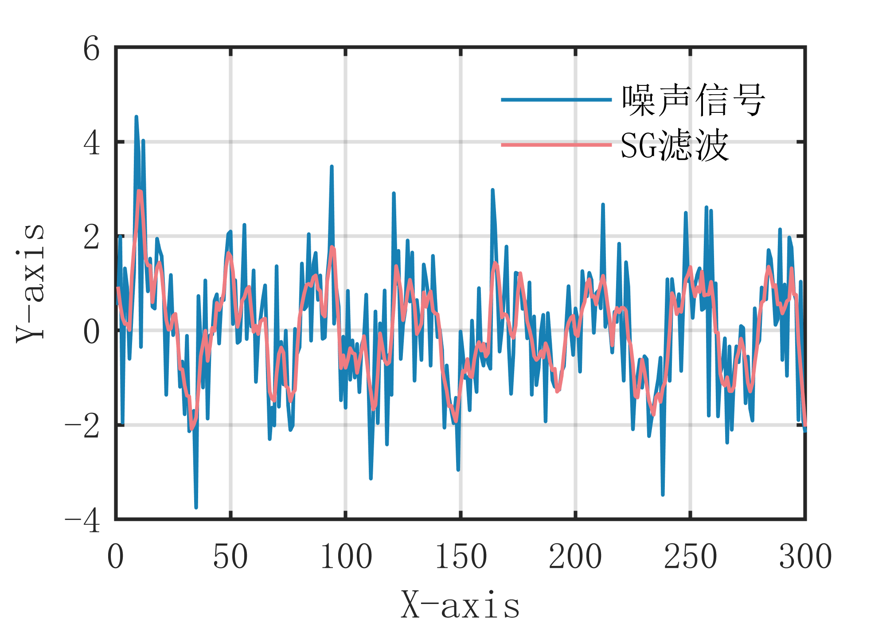

# MATLAB | Digital Signal Processing | SG Filtering Algorithm | Includes data and plotting code | Directly Useable

1. Basic Definition of SG Filtering Algorithm (Savitzky-Golay Filtering Algorithm)
The SG filtering algorithm is a digital signal processing technique used for smoothing signals. It employs the least squares method to fit local data segments, and then uses the fitted function to estimate the value of each data point, thereby achieving smoothing. The advantage of the SG filtering algorithm is that it can simultaneously achieve smoothing and denoising, effectively eliminating high-frequency noise, and has good adaptability to nonlinear signals. Additionally, this algorithm is computationally fast and does not require frequency domain conversion, making it suitable for real-time signal processing. However, the SG filtering algorithm has its drawbacks; it requires selecting appropriate window sizes and polynomial orders, as different parameters can affect the filtering effect. Moreover, the algorithm may produce significant errors in sections of the signal with significant local amplitude changes or steep slope variations. In practical applications, the SG filtering algorithm can be used for signal smoothing, denoising, and signal analysis.
2. Definition and Outline Effects
The following outline effects are attached:
\n        \n      Attach video tutorial operation:
\n        \n          \n          \n          \n          \n            To view this video please enable JavaScript, and consider upgrading to a\n            web browser that\n            supports HTML5 video\n

## Images

<!-- PAYMENT_BLOCK -->

## Get this dataset

- Payment link (Stripe): [Buy now](https://buy.stripe.com/3cs8yP7sY87d0vu9AB)
- Payment QR code: 

<!-- /PAYMENT_BLOCK -->
